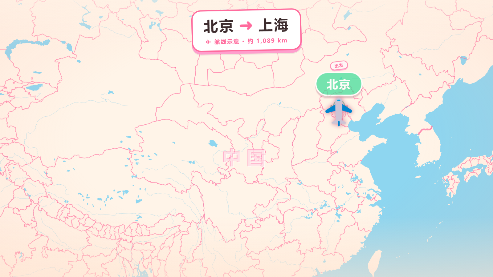
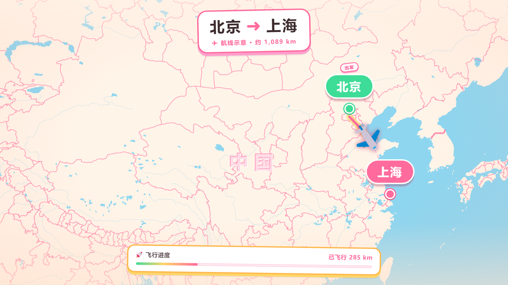

# amap-flyover

用起点和终点，生成一段**飞机沿航线飞过去**的网页动画。

浅色卡通贴纸风 · 高德路径数据 · Remotion 播放 · MapLibre 地图

适合旅行 vlog 包装、路线展示、Cursor Skill 一句话生成。

## 预览





## 能做什么

- 输入城市名或经纬度，生成示意航线动画
- 贴纸风 UI：标题、起终点标签、进度条、抵达提示
- 飞机可换成自己的图片
- 地图样式可选（默认卡通欢乐风）
- 也可装成 Cursor Skill：对 AI 说「北京到成都飞过去」即可生成

## 快速开始

### 1. 准备高德 Key

在 [高德开放平台](https://console.amap.com/) 创建 **Web 服务** Key。

### 2. 安装并运行

```bash
git clone https://github.com/cumerrain-png/amap-flyover.git
cd amap-flyover
cp .env.example .env   # Windows 可用: Copy-Item .env.example .env
```

编辑 `.env`：

```env
AMAP_KEY=你的高德Key
```

然后：

```bash
npm install
node scripts/generateGeoJSON.js --origin 北京 --destination 上海
npm run dev
```

浏览器打开 http://localhost:5173/ 。

换路线只需改起点终点，例如：

```bash
node scripts/generateGeoJSON.js --origin 杭州 --destination 成都
```

也支持经纬度：

```bash
node scripts/generateGeoJSON.js --origin 116.397428,39.90923 --destination 104.066541,30.572269
```

> 没有 Key 时也能先 `npm run dev`，会用仓库里的示例路线预览效果；真实路线需要 Key。

### 3. 改显示文案和样式（可选）

打开 `templates/PlayerApp.tsx`，可改：

```ts
originLabel: '北京',
destinationLabel: '上海',
mapStyle: 'cute',        // 地图风格，见下表
planeImageSrc: '/plane.png',  // 自定义飞机图（先放到 public/）
```

## 地图风格

| 值 | 效果 |
|----|------|
| `cute` | 默认，浅色卡通贴纸风 |
| `positron` | 浅色简洁 |
| `liberty` | 彩色 |
| `dark` | 深色 |
| `cartoDark` | Carto 深色 |

## 自定义图片

把图片放进 `public/`，再在 `PlayerApp.tsx` 里引用：

| 配置项 | 作用 |
|--------|------|
| `planeImageSrc` | 飞机 |
| `originImageSrc` | 起点图标 |
| `destinationImageSrc` | 终点图标 |

## 作为 Cursor Skill

希望一句话让 AI 帮你生成时：

```bash
npx skills add ./amap-flyover
# 或复制到 ~/.cursor/skills/amap-flyover/
```

之后对新对话说：「从上海飞到西安」，AI 会询问 Key（如需要）、可选地图风格，并启动预览。

详细约定见 [SKILL.md](SKILL.md)。

## 项目结构

```text
scripts/       拉取高德路线、坐标转换、写出 GeoJSON
templates/     动画组件与网页入口（Vite + Remotion）
data/          路线数据 route.geojson
public/        自定义图片
docs/          预览截图
references/    高德 API 说明
```

## 说明

- 航线是**示意弧线**（好看、好懂），不是贴地导航折线
- 高德坐标为 GCJ-02，进入地图前会转为 WGS-84
- Key 只放在 `.env`，不要提交到 Git

## License

[MIT](LICENSE)
